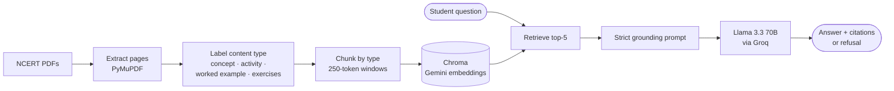

<div align="center">

# 📘 Study Assistant

**A study assistant for NCERT Class 9 Science that answers only from the textbook, cites every claim, and says so when it doesn't know.**


-F55036)


[How it works](#-how-it-works) · [Results](#-results) · [Quick start](#-quick-start) · [Project layout](#-project-layout) · [Docs](#-write-ups) · [License](#-license)

</div>

---

## 💡 Why this exists

Students in Tier-2 and Tier-3 cities often study without a tutor nearby. A general chatbot
will happily answer their questions, but it can't say *where* an answer came from, and it
will make one up when the textbook doesn't cover the topic. For exam preparation, a confident
wrong answer is worse than no answer.

PariShiksha is a **bounded** Retrieval-Augmented Generation (RAG) system:

| ✅ It will | 🚫 It won't |
|---|---|
| Answer from two NCERT Class 9 Science chapters | Use the model's general knowledge |
| Attach a `[Source: wk10_XXXX]` citation to every claim | Give an answer it can't trace to a chunk |
| Reply with one fixed refusal sentence for anything off-syllabus | Guess on out-of-scope questions |

Real answers from the evaluation run:

```text
Q: What is the SI unit of force and how is it defined?
A: The SI unit of force is Newton (N) and it is defined as the force that produces an
   acceleration of 1 m s–2 on an object of mass 1 kg [Source: wk10_0059]

Q: What is photosynthesis?
A: I don't have that in my study materials.
```

---

## 🧠 How it works



### 1. Content-aware chunking
Textbook pages aren't all alike, so they aren't all split the same way.

| Page type | How it's chunked | Why |
|---|---|---|
| **Worked example** | Kept whole | A problem must never be separated from its solution |
| **End-of-chapter** | One chunk per numbered question | Each question stands alone |
| **Concept / activity** | 250-token recursive splitter, 40-token overlap | Exact token counts (tiktoken `cl100k_base`) instead of word estimates |

Headers, figure captions and page numbers are stripped **line by line** before whitespace
is collapsed, so removing a caption can't swallow the rest of the page. The two chapters
(46 PDF pages) come out as **81 chunks**.

### 2. Retrieval
- **Dense (primary):** `gemini-embedding-001` vectors in a persistent Chroma collection, cosine similarity.
- **BM25 (baseline):** `rank_bm25` with content-type weighting. Concept pages get ×1.3 and exercise pages ×0.8, because exercises repeat the keywords as questions rather than answering them.

Both share one `retrieve(query, k)` interface, so you can switch with `--retriever bm25`.

### 3. Grounded generation
The strict prompt enforces three rules: use the context only, cite every claim as
`[Source: wk10_XXXX]`, and reply with an exact refusal sentence when the answer isn't in the context.
The code then parses the citations and **flags any chunk ID the model cited that it was never given**.
The comparison with a permissive prompt is in [`docs/prompt_design.md`](docs/prompt_design.md).

---

## 📊 Results

Twelve hand-scored questions across three axes: 6 direct, 3 paraphrased into everyday wording,
and 3 out of scope. The last out-of-scope question is deliberately one that *sounds* answerable.

| Metric | Baseline (v1) | After fix attempt (v2) |
|---|:---:|:---:|
| Correct | **8 / 9** | 7 / 9 |
| Partially correct | 1 / 9 | 1 / 9 |
| Grounded in retrieved text | **9 / 9** | 8 / 9 |
| Out-of-scope refused | **3 / 3** | 3 / 3 |
| Retrieval top-1 hit rate (10 queries) | 7 / 10 | — |

> **The fix made things worse, and that's documented on purpose.** A filter that dropped
> chunks under 50 words removed a supporting chunk for *"What is displacement?"* and the model
> correctly refused on thinner context. The remaining partial answer (the cricket-fielder question)
> turned out to be a gap in the textbook, not a retrieval bug. Full analysis:
> [`docs/fix_memo.md`](docs/fix_memo.md).

Re-check the numbers yourself from the scored CSVs:

```bash
python -m parishiksha score evaluation/eval_scored.csv
```

---

## 🚀 Quick start

**1. Install** (Python 3.10+)

```bash
python -m venv .venv
source .venv/bin/activate        # Windows: .venv\Scripts\activate
pip install -r requirements.txt
```

**2. Add API keys.** Both have free tiers.

```bash
cp .env.example .env             # then fill in GROQ_API_KEY and GEMINI_API_KEY
```

**3. Get the textbook chapters.** They are not committed, so download them from NCERT into `data/raw/`:
[Chapter 4: Describing Motion Around Us](https://ncert.nic.in/textbook/pdf/iesc104.pdf) ·
[Chapter 6: How Forces Affect Motion](https://ncert.nic.in/textbook/pdf/iesc106.pdf)

> Already-processed chunks ship in `data/processed/`, so you can skip this step unless you want to re-chunk.

**4. Build the index and ask**

```bash
python -m parishiksha index                      # embeds the 81 chunks once
python -m parishiksha ask "State Newton's third law of motion." --show-context
```

### Commands

| Command | What it does |
|---|---|
| `python -m parishiksha chunk` | PDFs in `data/raw/` → `data/processed/wk10_chunks.json` |
| `python -m parishiksha index [--rebuild]` | Embed chunks into Chroma (skips if already built) |
| `python -m parishiksha ask "…" [--retriever bm25] [-k 5] [--show-context]` | Answer one question |
| `python -m parishiksha evaluate [--out file.csv]` | Run the 12-question set for hand-scoring |
| `python -m parishiksha score [file.csv]` | Summarise a hand-scored CSV |
| `pytest` | Unit tests (no API keys or network needed) |

---

## 🗂 Project layout

```text
parishiksha/               the application, as an importable package
├── config.py              paths, model names and defaults (env-overridable)
├── ingest.py              PDF extraction, page labelling, text cleaning
├── chunking.py            content-aware, token-budgeted chunking
├── retrieval.py           BM25Retriever and DenseRetriever (Gemini + Chroma)
├── generation.py          strict prompt, citation parsing, StudyAssistant
├── evaluation.py          12-question set, CSV I/O, score summary
└── cli.py                 `python -m parishiksha …`
tests/                     pytest suite; LLM and retriever are faked
notebooks/experiments.ipynb  stage-by-stage experiment log with original outputs
data/processed/            chunks and retrieval logs
evaluation/                raw and hand-scored evaluation CSVs
docs/                      design notes and analysis
```

---

## 📝 Write-ups

| Document | What's inside |
|---|---|
| [`prompt_design.md`](docs/prompt_design.md) | Permissive vs strict prompt, with side-by-side outputs |
| [`chunking_diff.md`](docs/chunking_diff.md) | Word-based (Wk9) vs token-aware (Wk10) chunking |
| [`retrieval_misses.md`](docs/retrieval_misses.md) | The three top-1 retrieval misses, diagnosed |
| [`failure_modes.md`](docs/failure_modes.md) | Production failure modes and mitigations |
| [`fix_memo.md`](docs/fix_memo.md) | The junk-filter experiment and its negative result |
| [`wk9_evaluation.md`](docs/wk9_evaluation.md) | First 18-question evaluation (BM25 + Llama 3.1 8B) |
| [`reflection.md`](docs/reflection.md) | Design decisions and lessons learned |

---

## 🧭 Limitations and next steps

- **Definition queries drift.** *"What is displacement?"* pulls calculation-heavy chunks. Next step: a cross-encoder reranker and metadata filters that prefer concept chunks for "what is X" questions.
- **Equation lists can straddle chunks.** Keep equation-dense passages whole.
- **Hybrid retrieval** (BM25 + dense fusion) was prototyped in the notebook but isn't wired into the CLI yet.
- **English only.** Hindi support is needed before a real student pilot.
- **Small corpus.** Two chapters. The pipeline is chapter-agnostic: add PDFs to `Settings.chapters` in `config.py`.

---

## 📄 License

Released under the [MIT License](LICENSE).

The NCERT textbook PDFs are not included in this repository; they remain the property of NCERT and should be downloaded from [ncert.nic.in](https://ncert.nic.in/).
